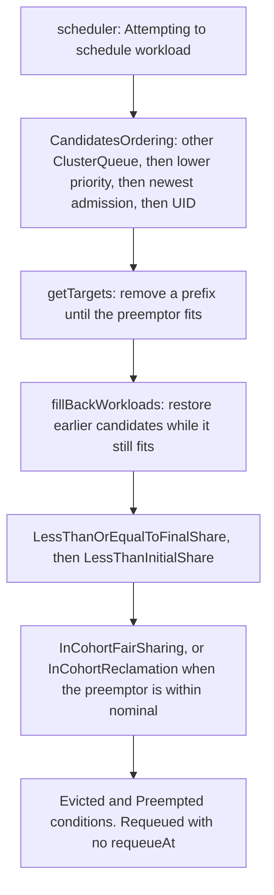

# Kueue v0.20.3 fair-share preemption

This repo is the evidence for a short article on how Kueue v0.20.3 chooses a workload to preempt under fair sharing. CPU stands in for GPUs on the kind clusters. The put-back unit test requests `nvidia.com/gpu`.

Two kind clusters and one unit-test harness are checked in. They answer different questions.

| Result | What it is |
|---|---|
| `cluster-logs/v0.20.3/` | Live kind, original session. Kueue release image `registry.k8s.io/kueue/kueue:v0.20.3`. kube-proxy was switched to nftables on the running cluster. This directory was not created from `repro/kind-config.yaml`. |
| `cluster-logs/v0.20.3-rerun/` | Live kind, second session. Cold `kind create cluster --config repro/kind-config.yaml`, nftables from the start. |
| `repro-logs/` | `go test` against Kueue's scheduler cache and preemptor. No cluster. Every admitted workload has the same admission time, so a UID tie-break picks the victim. |
| `cluster-logs/unit-harness/` | Earlier manual-run copies of the v0.19.1, v0.19.2, and v0.19.4 scenario and share lines. Same targets as `repro-logs/`. |

Nothing here was read from a private cluster. The metrics scrape uses a short-lived ServiceAccount token created at runtime and not stored.

The captures that mention a working directory used `/workspace` on the machine that ran them. See `cluster-logs/v0.20.3-rerun/setup/run-kind.txt`. Stack paths under `/workspace/vendor/` in controller logs come from the upstream Kueue image build.

## Versions

`repro/run-unit-repro.sh` checks out these commits. Each file in `repro-logs/` starts with the tag or label, the full commit, and the subject line from that run.

| Pin | Commit | Role |
|---|---|---|
| v0.19.1 | `df3d3656004f7b2478004a37b34ad8efa9ffabf0` | Before the +Inf early exit. One "Evaluating FairSharing strategy" line per candidate. |
| v0.19.2 | `8eab68778fc1b52affe165fdf5af29d1e9b4f3cb` | Has the early exit from [#14490](https://github.com/kubernetes-sigs/kueue/pull/14490) (cherry-pick [#14671](https://github.com/kubernetes-sigs/kueue/pull/14671)). Still the old `CompareBool`. |
| v0.19.4 | `5d738f203bd0d301d4966282b144f01d5bb32437` | Has [#14765](https://github.com/kubernetes-sigs/kueue/pull/14765) via [#14772](https://github.com/kubernetes-sigs/kueue/pull/14772) and [#15128](https://github.com/kubernetes-sigs/kueue/pull/15128) via [#15139](https://github.com/kubernetes-sigs/kueue/pull/15139). |
| v0.20.3 | `66ff21115867ef4a80ced2a662d3665d86cb0d78` | Both kind clusters, and the same harness on the current release line. |
| #14765 parent | `47f6e6483e1a6ef594e2172bcbded6f8c8d5328b` | `math.IsInf` early exit, before `ZeroWeightBorrows` was reused. |
| #14765 merge | `d7b9a364f6636f1a9d3ba2c949ebbcfba942f648` | Exports `ZeroWeightBorrows` and uses it. Same preemption targets. |
| #15128 parent | `284ed6a563dad96c85f34d07b5bf456e990ad120` | `CompareBool(true, false) == -1`. |
| #15128 merge | `73ada9494a84e85bb60598852a5228f1c412cda0` | `CompareBool(true, false) == +1`, arguments swapped at the call sites. Same order. |

The unit logs were produced with Go 1.27.3 (`GOTOOLCHAIN=local`). Kueue v0.20.3's `go.mod` requires Go 1.27.0. The v0.19 tags require Go 1.26.0 and build with 1.27. The harness was not run on v0.19.3.

The kind runs install the published manifest, not a build from source:

```text
https://github.com/kubernetes-sigs/kueue/releases/download/v0.20.3/manifests.yaml
```

Cluster tool versions are in `cluster-logs/v0.20.3/versions.txt` and `cluster-logs/v0.20.3-rerun/versions.txt`.

## Cohort, queues, and fair-sharing config

`repro/01-queues.yaml`:

- Cohort `all` holds 1 CPU of its own.
- ClusterQueue `team-a`, nominal 500m, `fairSharing.weight: "0"`, `reclaimWithinCohort: Any`, `withinClusterQueue: LowerPriority`.
- ClusterQueue `team-b`, the same with weight `"1"`.
- Lendable CPU is 1 + 0.5 + 0.5 = 2.
- LocalQueue `lq` in namespaces `team-a` and `team-b`.
- WorkloadPriorityClass `low` (0) and `high` (100).

The share is borrowing per thousand of what the parent cohort can lend, divided by the weight: `(borrowed / lendable) * 1000 / weight`. A weight-0 queue that borrows 1000m of 2000m lendable would have an unweighted share of 500. The weight is 0, so the share is +Inf. A weight-1 queue in that same spot has share 500.

`repro/02-queues-ordering.yaml` is the O/O2 overlay. Apply it on top of `01-queues.yaml`. It sets team-a weight 1 and nominal 1 CPU, and the cohort pool to 500m. team-b is unchanged.

`repro/kueue-config-fairsharing.yaml` turns on `fairSharing.preemptionStrategies` and `metrics.enableClusterQueueResources`. The strategies are `[LessThanOrEqualToFinalShare, LessThanInitialShare]`. Other uncommented manager fields match the v0.19.4 and v0.20.3 defaults. Integrations are only `batch/job`. The v0.20.3 release ConfigMap also enables MPIJob, Ray, JobSet, Pod, Deployment, StatefulSet, TrainJob, AppWrapper, and LeaderWorkerSet. This repro does not submit those.

The field on a ClusterQueue is `spec.cohortName`. A key named `cohort` is not that field. The v0.20.3 CRD rejects it. `repro/validate.py` rejects unknown fields against a release `manifests.yaml`:

```bash
python3 repro/validate.py /path/to/manifests.yaml repro/01-queues.yaml repro/02-queues-ordering.yaml
```

Needs PyYAML and jsonschema.

## Try it on kind

From the repo root, with kind, kubectl, Docker, curl, python3, and about 2 free CPUs:

```bash
kind create cluster --config repro/kind-config.yaml
cd repro
./run-kind.sh
```

`repro/run-kind.sh` creates cluster `kueue-fs` from `repro/kind-config.yaml` when that cluster does not already exist. The config sets `networking.kubeProxyMode: nftables`. On the machine used for these captures, kube-proxy's iptables backend did not program ClusterIP, so the Kueue webhooks timed out, likely because the kernel lacks `xt_statistic`. That missing module was not confirmed. The script also switches an existing cluster's kube-proxy ConfigMap to nftables if it is still on iptables.

The kind node in that environment could not open TCP to `registry.k8s.io`. The script pulls these images on the host, imports them into the node's containerd, and sets `imagePullPolicy: IfNotPresent`:

- `registry.k8s.io/kueue/kueue:v0.20.3`
- `registry.k8s.io/pause:3.10` (the scenario jobs)
- `registry.k8s.io/e2e-test-images/busybox:1.36.1-1` (the grace-period jobs)

Then it:

1. Installs `https://github.com/kubernetes-sigs/kueue/releases/download/v0.20.3/manifests.yaml`.
2. Installs `repro/kueue-config-fairsharing.yaml` as ConfigMap `kueue-system/kueue-manager-config` before the controller is rolled out, and sets `--zap-log-level=4` so the fair-sharing lines are logged.
3. Applies `repro/01-queues.yaml`. The first apply can race the webhook. In `cluster-logs/v0.20.3-rerun/setup/run-kind.txt` the first apply returned `InternalError` (connection refused to the webhook Service). `kubectl_apply` in `repro/run-kind.sh` retries. That failure is not a failed run.
4. Runs Z, Z2, Zc, O, and O2. Each job is a suspended `batch/v1` Job from `repro/job.sh`, image `registry.k8s.io/pause:3.10`, 500m CPU unless noted, label `kueue.x-k8s.io/queue-name: lq`. The script waits until the workload is admitted, then leaves three seconds before the next admission so `QuotaReserved` lastTransitionTime values fall in different seconds. Those timestamps have one-second resolution. Equal timestamps fall through to UID.
5. Runs the requeue measurement three times and the 30s grace measurement three times.

`./run-kind.sh --checks-only` skips image import, the Kueue install, and the five scenarios. It runs requeue and grace against the cluster that is already up.

Default output directory is `cluster-logs/v0.20.3/` next to `repro/`. The checked-in re-run used `OUT=cluster-logs/v0.20.3-rerun` via `repro/capture-rerun.sh`.

Metrics: the script creates ServiceAccount `kueue-system/metrics-probe`, binds it to ClusterRole `kueue-metrics-reader`, port-forwards `kueue-controller-manager-metrics-service` to localhost:18443, and curls `/metrics` with a 20-minute token. The token is not written to a file.

Scenario steps, as `repro/run-kind.sh` runs them:

| Scenario | Steps |
|---|---|
| Z | Apply `01-queues.yaml` (team-a weight 0). Admit a1, then b1, b2, b3 on team-b. Submit a2. |
| Z2 | Admit a1..a4 on team-a, capture while borrowing, then submit b1. |
| Zc | Same admissions as Z, after patching team-a `fairSharing.weight` to `"1"`. |
| O | Apply `01-queues.yaml` and `02-queues-ordering.yaml`. Admit a-low at 500m priority low, then b1..b3 at 500m low, then a-high at 1 CPU priority high. |
| O2 | Same as O, but a-high requests 500m. |

Grace runs use the Zc queue setup. The victim is job b3 with `terminationGracePeriodSeconds: 30`, image `registry.k8s.io/e2e-test-images/busybox:1.36.1-1`, command `sh -c trap '' TERM; sleep 86400`. The preemptor is job a2.

For each scenario the directory contains `clusterqueues.txt`, `fairsharing-status.txt`, `workloads.txt` (column `RESERVED_AT`), `conditions.txt`, `workloads.json`, `events-preempted-lines.txt`, `metrics.txt`, and `controller-fairsharing.log`. Z2 also has `while-borrowing/`, captured after a1..a4 are admitted and before b1 is submitted.

### Unit harness

```bash
cd repro
./run-unit-repro.sh
```

Needs Go >= 1.27, git, and python3. The script clones `kubernetes-sigs/kueue` into `${WORK:-/tmp/kueue-article-a}` and writes `repro-logs/`. It does not open issues or push. v0.19.x uses `repro/zz_article_a_shares_test.go`. v0.20.3 uses `repro/zz_article_a_shares_test.go.v0.20.3` (context on `AddOrUpdateWorkload`, `Usage` reports `ZeroWeightBorrows`, status goes through `SaturatingCeil`). `repro/mk_test.py` builds the scenario test from upstream `TestFairPreemptions` plus `repro/article_a_cases.go.txt`.

## What the two clusters did

Harness outcome, identical at v0.19.1, v0.19.2, v0.19.4, and v0.20.3. Logs: `repro-logs/v0.19.1-article-a-scenarios.log` and the same name for v0.19.2, v0.19.4, and v0.20.3. The earlier copies are `cluster-logs/unit-harness/k191-article-a-scenarios.log`, `k192-article-a-scenarios.log`, and `k194-article-a-scenarios.log`.

| Scenario | Harness (equal admission time, UID tie-break) | Live kind, original run |
|---|---|---|
| Z | no targets. a2 stays pending. | No `Preempted` event. a2 `QuotaReserved=False`. team-a share 0, team-b share 500. |
| Zc | `/b1` `InCohortFairSharing` | Job b3, workload `job-b3-8233e`, reason `InCohortFairSharing`. |
| Z2 | `/a1` `InCohortReclamation` | Job a4, workload `job-a4-865cb`, reason `InCohortReclamation`. |
| O | `/a-low` `InClusterQueue` and `/b1` `InCohortFairSharing` | a-low `InClusterQueue` and b3 `InCohortFairSharing`. |
| O2 | `/b1` `InCohortReclamation` | b3 `InCohortReclamation`. a-low stays admitted. |

`CandidatesOrdering` is what the cluster follows when admission times differ: other ClusterQueues before your own, then lower priority, then most recently admitted, then UID. Upstream at this commit: [pkg/scheduler/preemption/ordering.go](https://github.com/kubernetes-sigs/kueue/blob/66ff21115867ef4a80ced2a662d3665d86cb0d78/pkg/scheduler/preemption/ordering.go). The harness gives every admitted workload the same `QuotaReserved` time, so it stops at UID and names b1 or a1. That is the same ordering, not a different victim rule.

### Workload tables (RESERVED_AT)

First cluster, original run. Column `RESERVED_AT` is `QuotaReserved` lastTransitionTime.

- Z, no preemption: `cluster-logs/v0.20.3/Z/workloads.txt`
- Zc, b3 preempted: `cluster-logs/v0.20.3/Zc/workloads.txt` and `cluster-logs/v0.20.3/Zc/conditions.txt`
- Z2, a4 preempted: `cluster-logs/v0.20.3/Z2/workloads.txt` and `cluster-logs/v0.20.3/Z2/conditions.txt`
- Z2 while borrowing, before b1: `cluster-logs/v0.20.3/Z2/while-borrowing/workloads.txt`

On Zc, b3 is the only team-b workload with `Evicted`. Its `QuotaReserved` condition was overwritten to `False` in the same update that cleared the quota, so that field is not the original admission time. b1 and b2 stayed `QuotaReserved=True`. The same overwrite happens to a4 on Z2. The filtered fair-sharing log for original Z2, `cluster-logs/v0.20.3/Z2/controller-fairsharing.log`, is empty: reclamation did not log `Evaluating FairSharing`. The original run's `Preempted` event for `job-a4-865cb` is in `cluster-logs/v0.20.3/Z2/events-preempted-lines.txt`. The re-run's controller line at `preemption.go:328` for that scenario is `cluster-logs/v0.20.3-rerun/Z2/controller-target-job-a4-b3e3d.log` (`targetWorkload` `job-a4-b3e3d`, reason `InCohortReclamation`).

Second cluster, cold nftables re-run. Zc before preemption, b3 (`job-b3-3bb84`) `ADMITTED` True: `cluster-logs/v0.20.3-rerun/Zc/workloads-before.txt`. After, `ADMITTED` False: `cluster-logs/v0.20.3-rerun/Zc/workloads-after.txt`. Workload YAML before preemption: `cluster-logs/v0.20.3-rerun/Zc/workload-before-job-b3-3bb84.yaml`. After: `cluster-logs/v0.20.3-rerun/Zc/victim-workload-job-b3-3bb84.yaml`.

### ClusterQueue status, metrics, and YAML

Original run, Z, team-a weight 0 and not in the +Inf borrowing state: `cluster-logs/v0.20.3/Z/fairsharing-status.txt` and `cluster-logs/v0.20.3/Z/metrics.txt`. Status share 0 and 500. Metrics 0 and 500.

Original run, Z2 while borrowing: `cluster-logs/v0.20.3/Z2/while-borrowing/fairsharing-status.txt` and `cluster-logs/v0.20.3/Z2/while-borrowing/metrics.txt`. team-a status `weightedShare` is `9223372036854775807` (`math.MaxInt64`). The metric `kueue_cluster_queue_weighted_share` for team-a is `NaN`. team-b is 0.

The same digits come out of the v0.20.3 unit test. Share lines for all four tags: `repro-logs/v0.19.1-article-a-shares.log`, `v0.19.2-article-a-shares.log`, `v0.19.4-article-a-shares.log`, `v0.20.3-article-a-shares.log`. Earlier copies: `cluster-logs/unit-harness/k191-article-a-shares.log`, `k192-article-a-shares.log`, `k194-article-a-shares.log`. Z2 borrowing is precise `+Inf`, status `9223372036854775807`, metric `NaN`.

Re-run, same NaN while borrowing and after: `cluster-logs/v0.20.3-rerun/Z2/while-borrowing/metrics.txt` and `cluster-logs/v0.20.3-rerun/Z2/metrics.txt`. Status YAML for team-a: `cluster-logs/v0.20.3-rerun/Z/clusterqueue-team-a.yaml` and `cluster-logs/v0.20.3-rerun/Z2/while-borrowing/clusterqueue-team-a.yaml`. The original run stored ClusterQueue JSON (`cluster-logs/v0.20.3/Z/clusterqueues.json`), not YAML.

### Controller lines at log level 4

Original Z, weight-0 preemptor, `cluster-logs/v0.20.3/Z/controller-fairsharing.log`. `fair_strategy.go:284` logs "Skipping FairSharing strategy evaluation, no candidate can pass" with `preemptorNewShare` `+Inf`. `fair_strategy.go:332` logs "Evaluating FairSharing strategy" for a team-b workload with `strategyPassed` false.

Original Zc, `cluster-logs/v0.20.3/Zc/controller-fairsharing.log`. `fair_sharing_log.go:87` logs "Evaluating FairSharing strategy" for `team-b/job-b3-8233e` with `preemptorNewShare` 250, `targetNewShare` 250, `strategyPassed` true.

The unit-test form of the Z skip/evaluate pair is `repro-logs/v0.20.3-skip-log-lines-Z.log` and `repro-logs/v0.19.1-skip-log-lines-Z.log`. v0.19.1 prints one "Evaluating" line per team-b candidate. v0.19.2 and later print one "Skipping" line. Combined file: `repro-logs/skip-log-lines-Z.log`.

### O and O2

Original run.

- O: `cluster-logs/v0.20.3/O/workloads.txt`, `conditions.txt`, `events-preempted-lines.txt`. a-low `InClusterQueue` and b3 `InCohortFairSharing`.
- O2: `cluster-logs/v0.20.3/O2/workloads.txt`, `conditions.txt`, `events-preempted-lines.txt`. b3 `InCohortReclamation`. a-low stays `QuotaReserved=True`.

Re-run copies of the same scenarios: `cluster-logs/v0.20.3-rerun/O/` and `cluster-logs/v0.20.3-rerun/O2/`.

### Victim conditions and Preempted events

Original Zc, workload `job-b3-8233e`: `Evicted` and `Preempted` (`InCohortFairSharing`) in `cluster-logs/v0.20.3/Zc/conditions.txt`. The event is in `cluster-logs/v0.20.3/Zc/events-preempted-lines.txt` and `events-preempted.json`. `eventTime` on that event is `2026-10-26T04:26:58.719966Z`.

Original Z2, workload `job-a4-865cb`: `Preempted` reason `InCohortReclamation` in `cluster-logs/v0.20.3/Z2/conditions.txt` and `events-preempted-lines.txt`. `eventTime` `2026-10-26T04:26:28.528055Z`.

Re-run Zc victim YAML and events: `cluster-logs/v0.20.3-rerun/Zc/victim-workload-job-b3-3bb84.yaml` and `cluster-logs/v0.20.3-rerun/Zc/events-preempted-lines.txt`.

## Fair sharing, put-back, and cohorts

At v0.20.3 (`66ff2111`) the default strategies are `LessThanOrEqualToFinalShare`, then `LessThanInitialShare`. Config field: [apis/config/v1beta2/configuration_types.go](https://github.com/kubernetes-sigs/kueue/blob/66ff21115867ef4a80ced2a662d3665d86cb0d78/apis/config/v1beta2/configuration_types.go). The parser accepts only that pair, either one alone, or both in that order (`preemption.go`, `parseStrategies`).

`LessThanOrEqualToFinalShare` compares the preemptor's share after admission with the target's share with the victim removed. The comparison is `<=`. In Zc the two shares were equal (250 and 250) and b3 was evicted. A rule that required the victim's team to be strictly further over would predict the wrong outcome.

`LessThanInitialShare` is the fallback: strictly `<` the target's share before removal. The default runs both, in that order.

With `FairSharingPreemptWithinNominal` (Beta) and the preemptor still inside its nominal quota, the reason is `InCohortReclamation`, not `InCohortFairSharing`. That is Z2: b1 is within nominal and a4 is evicted for reclamation. `InCohortFairSharing` is the Zc path, where the incoming workload is still borrowing.

`getTargets` walks `CandidatesOrdering` and removes a prefix of candidates until the preemptor fits. `fillBackWorkloads` then walks that prefix from the end (`for i := len(targets)-2; i >= 0; i--`) and restores a candidate when the preemptor still fits. The candidate that made the preemptor fit stays removed. Upstream: [pkg/scheduler/preemption/preemption.go](https://github.com/kubernetes-sigs/kueue/blob/66ff21115867ef4a80ced2a662d3665d86cb0d78/pkg/scheduler/preemption/preemption.go).



Shares of two ClusterQueues are compared directly only when both have the same parent cohort. In a nested cohort, the comparison is between the nodes just below the lowest common ancestor. Cohort `all` in this repo is the flat case, so those nodes are `team-a` and `team-b`. These captures do not exercise a nested cohort.

[#16477](https://github.com/kubernetes-sigs/kueue/issues/16477) tracks two accounting cases this repo does not hit: a very large share that becomes an invalid `int64`, and a zero-weight borrower whose borrowing ratio is zero and which can be given share 0 instead of +Inf. Z2 is the other zero-weight case, where the ratio is not zero and the status value is `9223372036854775807`.

### Version history

| Release | What these logs show |
|---|---|
| v0.19.1 | No +Inf early exit. Z logs one Evaluating line per team-b candidate. Harness targets match later tags. |
| v0.19.2 | Early exit from #14490 / #14671. Old `CompareBool(true, false) == -1`. |
| v0.19.3 | Not a harness target in this repo. It sits between v0.19.2 and v0.19.4. |
| v0.19.4 | #14765 via #14772, and #15128 via #15139. `CompareBool(true, false) == +1`. Same preemption targets. |
| v0.20.3 | Same harness targets. Live kind runs are this release only. |

`repro-logs/cross-v0.19.2-cmp_test-on-v0.19.4-code.log` is v0.19.2's `TestCompareBool` against v0.19.4's `CompareBool`. It fails:

```text
cmp_test.go:55: CompareBool(true, false) = 1; want -1
cmp_test.go:55: CompareBool(false, true) = -1; want 1
```

The call sites were swapped in #15128, so the sort order stays the same. Parent and merge logs: `repro-logs/pr15128-parent.log`, `pr15128-merge.log`, `pr14765-parent.log`, `pr14765-merge.log`, `pr15128-newPodSortTests-on-parent-code.log`. `TestCompareBool` and `TestDominantResourceShare` on the release tags: `repro-logs/v0.19.2-cmp-drs.log`, `v0.19.4-cmp-drs.log`, `v0.20.3-cmp-drs.log`.

Related upstream changes, by their public URLs: [#14348](https://github.com/kubernetes-sigs/kueue/pull/14348), [#14490](https://github.com/kubernetes-sigs/kueue/pull/14490), [#14675](https://github.com/kubernetes-sigs/kueue/pull/14675), [#14765](https://github.com/kubernetes-sigs/kueue/pull/14765), [#15118](https://github.com/kubernetes-sigs/kueue/pull/15118), [#15128](https://github.com/kubernetes-sigs/kueue/pull/15128), [#16343](https://github.com/kubernetes-sigs/kueue/pull/16343), [#16487](https://github.com/kubernetes-sigs/kueue/pull/16487), [#16488](https://github.com/kubernetes-sigs/kueue/pull/16488), [#16528](https://github.com/kubernetes-sigs/kueue/pull/16528), [#16738](https://github.com/kubernetes-sigs/kueue/pull/16738).

### October fixes

| Change | Parent log | Merge log | What stayed the same |
|---|---|---|---|
| #14765 reuses `ZeroWeightBorrows` for the +Inf early exit | `repro-logs/pr14765-parent.log` | `repro-logs/pr14765-merge.log` | Preemption targets |
| #15128 flips `CompareBool` and swaps the call sites | `repro-logs/pr15128-parent.log` | `repro-logs/pr15128-merge.log` | Ordering. Pod-sort tests copied onto the parent still pass (`pr15128-newPodSortTests-on-parent-code.log`) |

## Requeue

A preempted workload is marked `Requeued=True`. `status.requeueState` is absent, so there is no `requeueAt` and no backoff on this path. `UpdateRequeueState` is the PodsReady-timeout backoff. `clearAdmissionAfterEviction` only sets the `Requeued` condition. See `requeueState: <absent>` in `cluster-logs/v0.20.3/requeue/run-1/report.txt` and `cluster-logs/v0.20.3-rerun/full-run/requeue/run-1/report.txt`.

The next admission attempt is the scheduler log `Attempting to schedule workload` at `scheduler/scheduler.go:476`. Measure that log time minus the `Preempted` event's `eventTime`. Both are the controller clock, with microsecond resolution.

The `delta_seconds` field in each `report.txt` is a different interval. It subtracts the `Requeued` condition's `lastTransitionTime`, and that condition is whole seconds. That number is not the scheduling latency.

On two kind clusters, six preemptions, the next `Attempting to schedule workload` came 75-85 ms after the `Preempted` event. No `requeueAt`, no backoff.

| Cluster | Run | Preempted eventTime | Next attempt | Delta |
|---|---|---|---|---|
| Original | 1 | `2026-10-26T04:32:41.684873Z` | `2026-10-26T04:32:41.768856439Z` | 0.084s |
| Original | 2 | `2026-10-26T04:33:11.847098Z` | `2026-10-26T04:33:11.922283285Z` | 0.075s |
| Original | 3 | `2026-10-26T04:33:41.849499Z` | `2026-10-26T04:33:41.926746252Z` | 0.077s |
| Re-run | 1 | `2026-10-26T05:17:45.496051Z` | `2026-10-26T05:17:45.576773Z` | 0.081s |
| Re-run | 2 | `2026-10-26T05:18:16.295306Z` | `2026-10-26T05:18:16.375599Z` | 0.080s |
| Re-run | 3 | `2026-10-26T05:18:47.175908Z` | `2026-10-26T05:18:47.260798Z` | 0.085s |

Original files: `cluster-logs/v0.20.3/requeue/run-N/events-preempted.json` and `report.txt`. Re-run files: `cluster-logs/v0.20.3-rerun/full-run/requeue/run-N/events-preempted.json` and `report.txt`. Deltas are rounded to milliseconds. The attempt timestamp minus `eventTime` is 0.083983s, 0.075185s, 0.077247s on the original cluster and 0.080722s, 0.080293s, 0.084890s on the re-run.

On the requeued workload, `Admitted` is `False` with reason `NoReservation` at that same whole second. Original run 1: `cluster-logs/v0.20.3/requeue/run-1/conditions.txt`, workload `job-b3-407b3`.

## Grace period

The 30s grace period did not delay admission. Preemptor `Admitted` and victim `Evicted` fall in the same second on every run. Both times are Workload condition timestamps, one-second resolution.

Original cluster, `cluster-logs/v0.20.3/grace/run-N/report.txt`:

| Run | Evicted | Admitted | Delta |
|---|---|---|---|
| 1 | `2026-10-26T04:34:12Z` on `job-b3-28f84` | `2026-10-26T04:34:12Z` on `job-a2-a1f1b` | 0s |
| 2 | `2026-10-26T04:34:39Z` on `job-b3-5335f` | `2026-10-26T04:34:39Z` on `job-a2-f9cc5` | 0s |
| 3 | `2026-10-26T04:35:06Z` on `job-b3-c0e75` | `2026-10-26T04:35:06Z` on `job-a2-9b46a` | 0s |

The victim pod stays up until `deletionTimestamp`. For a batch Job, `IsActive` is `status.active != 0`. The job controller drops that count when the pod is marked for deletion, and `clearAdmissionAfterEviction` then releases quota. The process can still be ignoring SIGTERM.

First cluster, pod lists:

- Run 1. `cluster-logs/v0.20.3/grace/run-1/victim-pod-before.json` and `report.txt`. Victim `b3-wxvml` still running in a capture taken while `deletionTimestamp` was `2026-10-26T04:34:42Z`, after the preemptor was already admitted at `04:34:12Z`.
- Run 2. `cluster-logs/v0.20.3/grace/original-run-transcript/run2-victim-about-28s-and-run3-pods-wide.txt`. Victim `b3-vndlt` still Terminating. There is no `deletionTimestamp` capture for this pod, and no watch until the pod was gone.
- Run 3. `cluster-logs/v0.20.3/grace/run-3/pod-still-running.txt`. At `2026-10-26T04:35:15.957854909Z`, pod `b3-pbnsk` was still `Running` (container `startedAt` `2026-10-26T04:35:03Z`) with `deletionTimestamp` `2026-10-26T04:35:36Z`. The preemptor had been admitted at `04:35:06Z`. That file is hand-written. The same observation is the tail of `cluster-logs/v0.20.3/grace/run-3/report.txt`.

The original session did not record a cold kind create, run 2's `deletionTimestamp`, the ~9s phase for runs 1 and 2, or a `POD_GONE` time. The re-run covers those on the second cluster.

Re-run, full scenario pass: `cluster-logs/v0.20.3-rerun/full-run/grace/run-N/grace-timeline.txt` and `pods-all-watch.txt`. `poll_nearest_9s_after_evicted` is the victim pod (`b3-*`), phase `Running`, with `deletionTimestamp` already set. An earlier draft of `repro/grace_timeline.py` picked the first pod in the poll, which was coredns. The checked-in timelines were regenerated from the existing poll files.

| Run | Evicted | deletionTimestamp | POD_GONE |
|---|---|---|---|
| 1 | `2026-10-26T05:19:18Z` | `2026-10-26T05:19:48Z` on `b3-h89jd` | `2026-10-26T05:19:48.841340967Z` |
| 2 | `2026-10-26T05:20:14Z` | `2026-10-26T05:20:44Z` | `2026-10-26T05:20:45.278168934Z` |
| 3 | `2026-10-26T05:21:10Z` | `2026-10-26T05:21:40Z` on `b3-j8s7q` | `2026-10-26T05:21:41.824018041Z` |

Runs 2 and 3's `POD_GONE` lines are in those same `grace-timeline.txt` files. `delta_evicted_to_admitted_seconds` is 0 on all three. The checks-only pass on the same cluster is `cluster-logs/v0.20.3-rerun/grace/run-N/`. Its ~9s line is also the `b3` pod.

## Put-back unit test

`TestArticleAPutBack` is a unit test written for this repro, in `repro/zz_article_a_putback_test.go`. It is not an upstream Kueue test. `repro/capture-putback.sh` copies it into an unmodified Kueue v0.20.3 worktree (`66ff21115867ef4a80ced2a662d3665d86cb0d78`, `pkg/scheduler/preemption/`) and runs `go test`. The log the article cites is `cluster-logs/v0.20.3-rerun/unit/TestArticleAPutBack.log`. An earlier run of the same file is `repro-logs/v0.20.3-putback-8-then-1.log`.

Nominal quota is 9. The preemptor requests 8. Candidates are ordered by `CandidatesOrdering` on `QuotaReserved` time, using `nvidia.com/gpu`.

With the 8-GPU workload first, the 1-GPU workload is never removed. The prefix that first fits has length 1, so the put-back loop starts at -1 and does not run. Put-back only matters when the 1-GPU workload comes first. Both are removed, then `fillBackWorkloads` restores the 1-GPU workload because the preemptor still fits. Final targets are the 8-GPU workload in both orders. The test log says this in the `PUTBACK` lines. Go 1.27.3, exit 0. The worktree commit is the body of `cluster-logs/v0.20.3-rerun/unit/kueue-rev-parse.txt`.

## Where each result comes from

Live kind, original run. Cluster `kueue-fs`, release image `registry.k8s.io/kueue/kueue:v0.20.3`. kube-proxy was switched to nftables on the running cluster. `repro/kind-config.yaml` was not the create config for this directory.

- `cluster-logs/v0.20.3/Z/`
- `cluster-logs/v0.20.3/Z2/` and `cluster-logs/v0.20.3/Z2/while-borrowing/`
- `cluster-logs/v0.20.3/Zc/`
- `cluster-logs/v0.20.3/O/`
- `cluster-logs/v0.20.3/O2/`
- `cluster-logs/v0.20.3/requeue/run-1/`, `run-2/`, `run-3/`
- `cluster-logs/v0.20.3/grace/run-1/`, `run-2/`, `run-3/`
- `cluster-logs/v0.20.3/grace/original-run-transcript/` is a verbatim copy of a `kubectl get pods -A -o wide` from that session. The first line of each file says so.
- `cluster-logs/v0.20.3/versions.txt`, `nodes.txt`, `kueue-deploy.txt`

Live kind, re-run, cold nftables cluster. Created with `kind create cluster --config repro/kind-config.yaml`. `cluster-logs/v0.20.3-rerun/setup/kind-create.txt` records that command, exit 0. `cluster-logs/v0.20.3-rerun/setup/kube-proxy-configmap.yaml` has `mode: nftables`. `cluster-logs/v0.20.3-rerun/INDEX.md` lists every file.

`repro/capture-rerun.sh` recorded the shell status of `./run-kind.sh` and `./run-kind.sh --checks-only` in `cluster-logs/v0.20.3-rerun/setup/run-kind.exit.txt` and `run-kind-checks-only.exit.txt`. Each body is the single character `0`. Those files are written by the wrapper, not raw command output. The wrapper prints `full_exit=... checks_only_exit=...` on its own stdout. That line is not stored in this tree, and there is no captured `WRAPPER_EXIT` line. Do not read the exit files as a raw transcript of a clean exit.

Unit test. No cluster. Each `repro-logs/` header has the Kueue commit and the Go version.

- `repro-logs/v0.19.1-*.log`, `v0.19.2-*.log`, `v0.19.4-*.log`, `v0.20.3-*.log`
- `repro-logs/pr14765-*.log`, `pr15128-*.log`, `cross-v0.19.2-cmp_test-on-v0.19.4-code.log`, `skip-log-lines-Z.log`
- `repro-logs/v0.20.3-putback-8-then-1.log`
- `cluster-logs/v0.20.3-rerun/unit/TestArticleAPutBack.log`
- `cluster-logs/unit-harness/` for the earlier v0.19.x manual-run copies

`kueue_commit` on `cluster-logs/v0.20.3-rerun/setup/kind-create.txt`, its `.stderr`, and the files in `cluster-logs/v0.20.3-rerun/unit/` was `unknown` at capture, because the header was written before the commit was known. It is now `66ff21115867ef4a80ced2a662d3665d86cb0d78`. The header note says it was corrected from `kueue-rev-parse.txt`. The bytes after `===== capture body =====` were not edited. Unit-test headers do not list kind, kubectl, or the node image.

### Not raw command output

`SUMMARY (hand-written, not raw output)` is only for files that were written by hand:

- `cluster-logs/v0.20.3/SUMMARY.txt`
- `cluster-logs/v0.20.3/AUTHORED.txt`
- `cluster-logs/v0.20.3/grace/run-3/pod-still-running.txt`
- the hand-written tail of `cluster-logs/v0.20.3/grace/run-3/report.txt`

Script output starts with `DERIVED (generated by <script> from raw output)`. That includes `report.txt`, `conditions.txt`, `fairsharing-status.txt`, `events-preempted-lines.txt`, `workloads.json`, `grace-timeline.txt`, the re-run `SUMMARY.txt`, `INDEX.md`, `versions.txt`, and the two exit files. `cluster-logs/v0.20.3/AUTHORED.txt` lists the original-run cases. Do not cite a DERIVED or SUMMARY file as kubectl, kind, curl, or controller output. Cite the raw file next to it.

## Article claims and evidence

| Claim | Evidence | Result |
|---|---|---|
| Z: no preemption, shares 0 and 500, metrics 0 and 500 | `cluster-logs/v0.20.3/Z/workloads.txt`, `fairsharing-status.txt`, `metrics.txt` | live kind (original run) |
| Z ClusterQueue YAML, weight 0, `cohortName: all` | `cluster-logs/v0.20.3-rerun/Z/clusterqueue-team-a.yaml` | live kind (re-run, cold nftables cluster) |
| Zc: b3 `InCohortFairSharing`, shares 250 and 250, `strategyPassed` true | `cluster-logs/v0.20.3/Zc/events-preempted-lines.txt`, `conditions.txt`, `controller-fairsharing.log` | live kind (original run) |
| Zc workload table with `RESERVED_AT` | `cluster-logs/v0.20.3/Zc/workloads.txt` | live kind (original run) |
| Z2 workload table with `RESERVED_AT` | `cluster-logs/v0.20.3/Z2/workloads.txt` | live kind (original run) |
| Second-cluster Zc before and after, and b3 YAML | `cluster-logs/v0.20.3-rerun/Zc/workloads-before.txt`, `workloads-after.txt`, `workload-before-job-b3-3bb84.yaml` | live kind (re-run, cold nftables cluster) |
| Z2: a4 `InCohortReclamation` | `cluster-logs/v0.20.3/Z2/events-preempted-lines.txt`, `conditions.txt` | live kind (original run) |
| Z2: status `9223372036854775807`, metric `NaN` | `cluster-logs/v0.20.3/Z2/while-borrowing/fairsharing-status.txt`, `metrics.txt` | live kind (original run) |
| Z2: same NaN on the second cluster | `cluster-logs/v0.20.3-rerun/Z2/while-borrowing/metrics.txt`, `Z2/metrics.txt` | live kind (re-run, cold nftables cluster) |
| O: a-low and b3. O2: b3 only | `cluster-logs/v0.20.3/O/`, `cluster-logs/v0.20.3/O2/` | live kind (original run) |
| Harness targets and SHARE lines at v0.19.1, v0.19.2, v0.19.4, v0.20.3 | `repro-logs/v0.19.*-article-a-scenarios.log`, `v0.19.*-article-a-shares.log`, and the v0.20.3 pair. Earlier copies in `cluster-logs/unit-harness/` | unit test |
| V(4) Skipping and Evaluating lines | `cluster-logs/v0.20.3/Z/controller-fairsharing.log`, `Zc/controller-fairsharing.log`. Unit form: `repro-logs/v0.20.3-skip-log-lines-Z.log` | live kind (original run), and unit test |
| `TestCompareBool` failure | `repro-logs/cross-v0.19.2-cmp_test-on-v0.19.4-code.log` | unit test |
| Requeue 75-85 ms after `Preempted`, no `requeueAt` | `cluster-logs/v0.20.3/requeue/run-N/`, `cluster-logs/v0.20.3-rerun/full-run/requeue/run-N/` | live kind (original run) and live kind (re-run, cold nftables cluster) |
| Grace does not delay admission. Victim stays Running | `cluster-logs/v0.20.3/grace/`, `cluster-logs/v0.20.3-rerun/full-run/grace/` | live kind (original run) and live kind (re-run, cold nftables cluster) |
| Cold create from `repro/kind-config.yaml`, nftables, kind-create exit 0 | `cluster-logs/v0.20.3-rerun/setup/kind-create.txt`, `kube-proxy-configmap.yaml` | live kind (re-run, cold nftables cluster) |
| `run-kind.sh` and `--checks-only` shell status 0, recorded by the wrapper | `cluster-logs/v0.20.3-rerun/setup/run-kind.exit.txt`, `run-kind-checks-only.exit.txt` | live kind (re-run, cold nftables cluster). Not raw stdout |
| Put-back: 8-GPU first never removes the 1-GPU workload. Put-back runs only when the 1-GPU workload is first | `repro/zz_article_a_putback_test.go`, `cluster-logs/v0.20.3-rerun/unit/TestArticleAPutBack.log` | unit test |

## License

Apache License 2.0. See `LICENSE` and `NOTICE`. Upstream Kueue is Copyright The Kubernetes Authors, also Apache-2.0. `repro/mk_test.py` copies the body of upstream `TestFairPreemptions` into a temporary worktree and keeps Kueue's copyright header. That generated file is not committed here.
